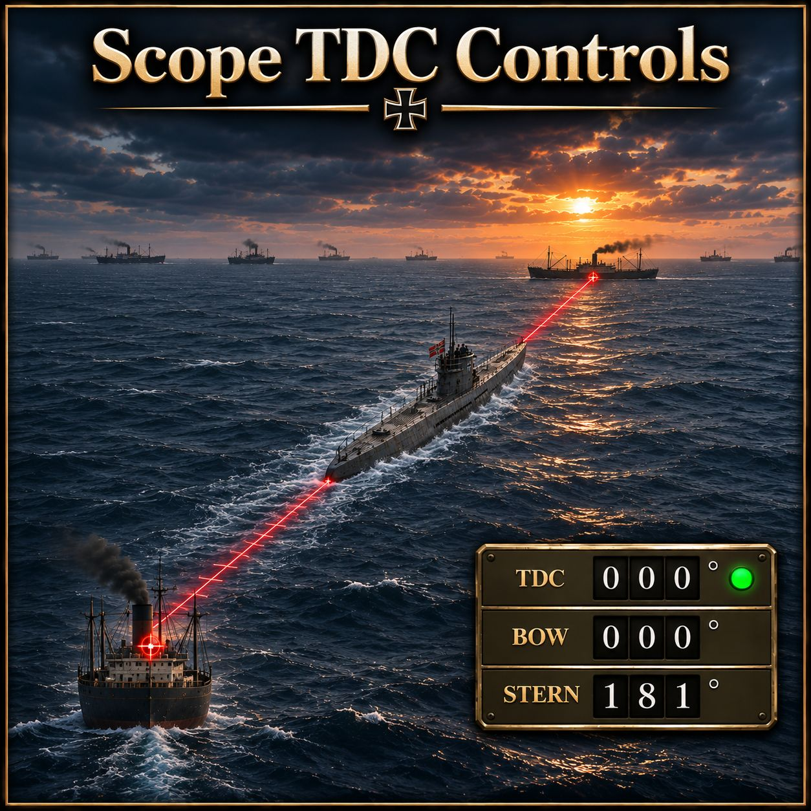

# Scope TDC Controls

A mod for **UBOAT** (built for 2026.1 patch 21) that adds SH3-style TDC readouts and fire-control controls to the periscope and UZO views, inspired by the gyro angle displays of GWX and OneAlex.

**Steam Workshop:** https://steamcommunity.com/sharedfiles/filedetails/?id=3843459058



## Features

### Rolling drum counters
Compact mechanical-style counters under the bearing tape. Every drum rolls over like a real odometer, including 359 → 000.

- **TDC**: the gyro angle (Schusswinkel) computed by the TDC
- **Parallax**: the parallax correction the TDC adds (+/-)
- **Bow / Stern**: the angle the tube gyros are actually set to
- **Gyro-set lamp**: green = set, red = synchronizing, dark = receiver off
- Greyed out with "TDC not manned" while nobody is at the TDC
- **Double-click a Bow/Stern counter** to switch to that receiver: the scope swings until the TDC angle matches what those tubes are already set to

### Fire-control panel
Beside the periscope raise/lower control:

- **Target bearing**: Following / Not following (blue lamp while not following)
- **Bearing source**: None, UZO, Observation or Attack periscope
- **Gyro angle receiver**: Off, Bow or Stern
- **Parallax mode**: Forward or Backward
- Shown or hidden with a button added to the periscope screen's stock left sidebar

### TDC dials
A window on the left of the scope with the TDC's **AOB**, **target speed** and **target distance** dials. Grab a dial and turn it, just like on the TDC; Shift for fine adjustment, mouse wheel for steps, exact readout under each dial. Shown and hidden with the sidebar button together with the panel.

### Raise fully / lower fully
Two buttons above and below the stock periscope raise/lower control run the periscope all the way up or down at its normal speed.

### Settings (saved between sessions)
Show receiver angle · Show active receivers only · Show parallax · Auto set receiver · Auto set parallax · Realistic TDC follower · Realistic receiver sync · Single torpedo launch fix · TDC operator required

### Fixes to the base game
- **Single torpedo launch fix**: a tube checked a few seconds after pressing fire is no longer launched too
- The torpedo panel no longer forces the gyro receiver to **Bow** whenever a bow tube is flooded
- **Not following** holds while a target is locked
- Hiding/showing the torpedo panel no longer changes the tube selection; the fire-control box tube selector stays in step

English and German (follows the game's language), pop-up descriptions on every element, Ctrl+drag to reposition. See [`mod/README.txt`](mod/README.txt) for full details and all settings.

## How it works

Everything is done at runtime: UBOAT compiles the C# files in `mod/Source` when the mod loads, and the mod applies [Harmony](https://github.com/pardeike/Harmony) patches in memory. No game files are modified, and nothing is stored in save games. Settings live in `scope-tdc-controls-config.txt` in `%USERPROFILE%\AppData\LocalLow\Deep Water Studio\UBOAT\`.

## Repository layout

```
mod/            the mod itself (this is what goes to the Workshop)
  Manifest.json
  README.txt    player documentation
  Preview.jpg   Workshop thumbnail
  Source/       C# source, compiled by the game
workshop/
  description.bbcode.txt   Steam Workshop page description (Steam BBCode)
```

The UBOAT Launcher replaces the Workshop description with the plain one from `Manifest.json` on every update, so paste `workshop/description.bbcode.txt` back into the Workshop page afterwards.

### Developing
Keep the repo anywhere outside the game folders and point the game's mod folder at `mod/` with a directory junction, so `.git` never ends up in a Workshop upload (the UBOAT Launcher uploads every folder inside the mod):

```powershell
New-Item -ItemType Junction -Path "$env:USERPROFILE\AppData\LocalLow\Deep Water Studio\UBOAT\Mods\scope-tdc-controls" -Target "<repo>\mod"
```

Then upload or update the Workshop item from the UBOAT Launcher as usual.

## License

[MIT](LICENSE)
